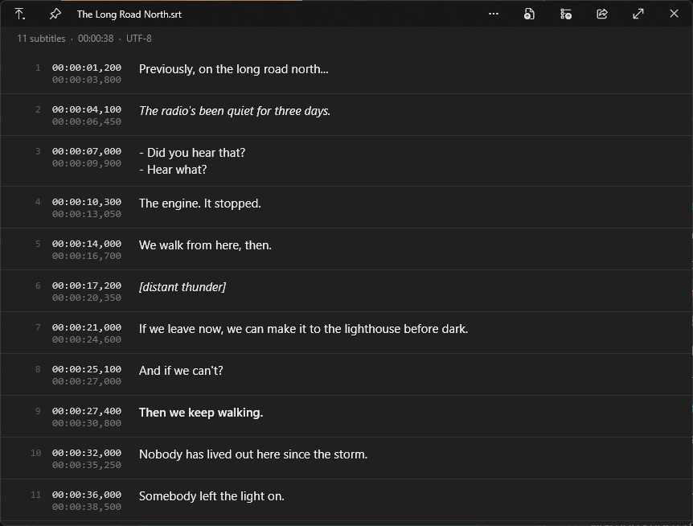

# QuickLook.Plugin.SrtViewer

Previews `.srt` subtitle files in [QuickLook](https://github.com/QL-Win/QuickLook) as a clean list of cues instead of raw text.

- Each cue shows its number, start and end time, and the text
- Italic, bold and underline tags are rendered; `` and `{\an8}`-style tags are hidden
- The header shows the cue count, total length and file encoding
- Reads UTF-8, UTF-16 and Windows-1252 files
- Handles large files smoothly (the list is virtualized)

## Install

Download `QuickLook.Plugin.SrtViewer.qlplugin` from [Releases](../../releases/latest), select it in Explorer, press Space and click "Click here to install this plugin", then "Restart now".

Tested on QuickLook 4.5.0 (Microsoft Store version).

To uninstall, delete the `QuickLook.Plugin.SrtViewer` folder and restart QuickLook. It's in:

- `%APPDATA%\pooi.moe\QuickLook\QuickLook.Plugin\` (installer version)
- `%LOCALAPPDATA%\Packages\21090PaddyXu.QuickLook_egxr34yet59cg\LocalCache\Roaming\pooi.moe\QuickLook\QuickLook.Plugin\` (Store version)

## Build

Needs the .NET SDK. Run `.\pack.ps1`, the plugin ends up in `dist\`.

`lib\QuickLook.Common.dll` comes from a QuickLook 4.5.0 install and is only used to compile.

## License

GPL-3.0, same as QuickLook.
